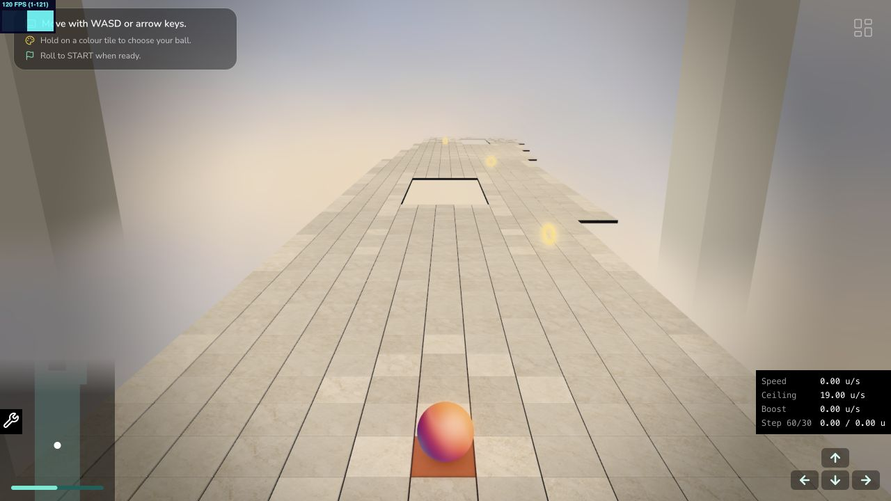
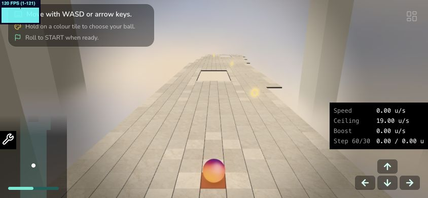

# Ivory tile slabs

The floor now uses bevelled ivory slabs with recessed graphite joints and shallow normal-map relief. Colliders, their top height, bitmap layout and gameplay remain unchanged.

## Geometry

`utils/platform/tileSlabGeometry.ts` creates one 36-triangle shape per batch geometry (the previous box was 12 triangles). Its `slabSurface` attribute selects graphite (0), ivory bevel/edge (1) or ivory top (2). Each batch needs its own geometry container for seed, highlight and trail instance attributes.

The local top stays at `TILE_THICKNESS / 2` around the existing pivot. Visual depth extends 0.18 units down from there. Ivory sections are 0.98 units wide; a 0.008-unit bevel leaves a 0.964-unit flat top. The 0.02-unit joint rests on a graphite perimeter 0.025 units below the top. Full-width graphite bases meet between tiles; holes in the course are never filled. Bounds include the lower body and maximum fade rotation.

## Material and relief

`Tiles.tsx` uses MeshLambertNodeMaterial with a material-specific light list: white ambient fill and a warm-white key from (-3, 6, 4). No scene lights or shadow maps are added. The proposed 0.8/1.6 intensities made ivory too dim in the actual course; visual tuning uses **1.4 ambient / 2.2 directional**. The old binary side-darkening is removed.

The existing colour atlas, stable seed selection, brightness variation and highlighted markings remain. Only ivory tops receive micro-relief. Tangent normals map into the top's +X/-Z UV basis, then rotate with the tile before conversion to view space. Bevels and graphite use geometric normals. Trail tint, emissive MRT, contact shadow, transparency, tilt and background-matched fog remain connected.

Low omits the normal-map sample. Medium/High/Ultra sample the same normal atlas; geometry and collider dimensions are identical at every quality. Normal data is loaded with NoColorSpace, mipmaps and the same padded cell coordinates as colour data.

## Asset authoring

- `assets/textures/platform/source/ivory-stone-height-source.png`: generated grayscale source, based on the existing colour atlas using the built-in image-generation tool, 25 October 2026.
- `assets/textures/platform/ivory-stone-height.png`: 1536×1536 grayscale RGB atlas; nine 512px cells, 480px interiors, duplicated 16px gutters.
- `assets/textures/platform/ivory-stone-normal.png`: corresponding RGB tangent-space normal atlas.
- Rebuild both outputs with `node scripts/bakeStoneNormals.mjs`.

The baker softly filters each source cell, computes central differences at a 0.001-unit full-range height amplitude using the 0.964-unit top width, reverses PNG row derivatives into texture V, then duplicates normal edges. Normal cells are baked separately; their padding never contributes to derivatives. The height texture is an offline source, not an additional runtime sample. Actual relief is intentionally subtler than the full amplitude because the source uses a narrow grayscale range.

Generation prompt: “Create a corresponding grayscale HEIGHT/DISPLACEMENT DATA MAP for this exact 3x3 ivory stone atlas. Preserve the nine-cell arrangement and approximate placement of the pores and faint veins. Flat orthographic texture data, not a render. Mid grey smooth stone surface, tiny shallow darker pores, fine very low contrast grain and extremely restrained vein relief. No illumination, no shadows, no highlights, no bevels, no grout, no directional shading, no perspective, no text. Each of nine samples fills its cell. Do not draw grid lines. All cells same middle-grey baseline and low contrast. Intended 1536x1536 square atlas. This map will be used for very shallow relief on polished/honed stone; not rugged rock.”

## Validation

Geometry tests cover top height, bottom depth, joint/bevel dimensions, graphite recess height, normals and bounding volumes. Atlas tests cover all nine distinct cells and every gutter pixel. A ramp fixture verifies the normal baker's UV orientation and determinism. Full TypeScript, lint and test results are recorded after final browser review.

Physical mobile GPU timing and final visual approval remain outstanding. This pass adds no copper seams, roughness/specular response or displacement.

### Browser comparison, 25 October 2026

Actual game scene at recovery distance 600, 1280×800 viewport, DPR cap 1.5, Ultra quality, idle sphere. Temporary `useFrame` instrumentation discarded 180 frames and sampled 360, then was removed. Baseline used the previous box/basic-material implementation with the current shared course and distance constants. Two runs per variant:

| Variant | Draw calls | Visible triangles | Median frame spacing | p05–p95, run 1 / run 2 |
| --- | ---: | ---: | ---: | --- |
| Previous boxes | 35 | 47,661 | 8.3 ms | 8.2–16.7 / 8.0–16.7 ms |
| Bevelled slabs | 35 | 95,013 | 8.3 ms | 8.2–8.4 / 8.2–9.1 ms |

These are browser frame intervals and submission counts, **not GPU timestamp measurements**. Both variants approach the display's 120 Hz cadence; the differing tails do not establish a speedup. The main measurable cost is the increased geometry and one extra normal texture sample outside Low. Concurrent development and a single machine limit the comparison; hardware mobile timing remains open.

The timing samples preceded the final correction to transform tilted normals into view space with Three's `transformNormalToView`; final GPU cost was not separately timed. Draw-call and geometry counts are unchanged by that correction.

### Final checks

- [x] 63 existing and new tests pass.
- [x] TypeScript and focused lint pass; no diff whitespace errors.
- [x] Desktop gameplay view and 844×390 landscape viewport reviewed.
- [x] Low/High material rebuild, clean reload, recovery respawn, contact/trail and hole/ring visibility checked.
- [ ] Full-speed end-to-end race/retry playtest and physical mobile GPU validation.
- [ ] User approval of bevel width, graphite contrast and final relief strength.

