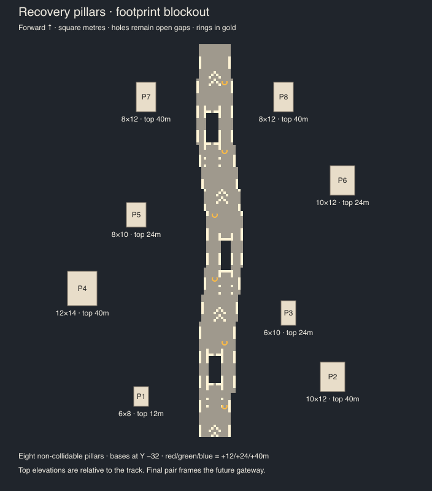

# Recovery-section pillar blockout

Implemented first architecture pass for The Fold. Eight authored ivory cuboids accompany the recovery straight; permanent staggered pillars now extend along the rest of the speedrun route. No beams, model textures, copper seams, assembly animation, physics or terrain changes are included. Floating tiles remain disabled.

## Source and generated files

- Author `assets/platform/1.2.0/architecture/recovery.png` at exactly **161 × 160** pixels. Never resize or antialias it.
- Run `npm run build-platform`. This validates the bitmap and clearance against the generated playable floor, then writes `resources/recoveryPillars.json` and `docs/race-course/recovery-pillars.svg` / `.png`.
- Runtime imports `resources/coursePillars.json`, combining the recovery bitmap placements with deterministic additions from `scripts/utils/createCoursePillars.ts`. `FIRST_PILLAR_DISTANCE`, `PILLAR_SPACING` and `PILLAR_TRACK_CLEARANCE` control the added layout. It alternates sides, cycles existing dimensions, derives course bounds from the start/finish markers and leaves the recovery section unchanged. Both placement lists are regenerated by `npm run build-platform`; the recovery preview remains focused on the original eight pillars. Runtime imports only the generated placement JSON. Architecture never enters rows, collision, respawn or pickup data. Existing checker/chevron decoration masks remain as historical artwork inputs; their detached tiles are no longer rendered, superseded by the new architecture. Playable-floor markings remain unchanged.
- Renderer: `components/platform/scenery/Pillars.tsx`. Spatial batches share an ivory node material; each owns a box geometry with a static per-instance world-Z attribute. Bounds and transforms are calculated on creation; no per-frame placement work. `useRouteFadeIn` adapts Threenix landing’s vertex-stage route fade using Speedroller’s existing `fadeInOut` math and player-position uniform. `utils/sceneDistances.ts` co-locates camera far distance, terrain/element reveal distances and the existing optional near-camera fade constants. Pillars fade independently, reverse their fade when backing away, and remain opaque after passage. The orbit inspection disables fading and needs no game uniforms.
- Fog: `components/backdrop/HeightFog.tsx`, installed through `useLocalNodes` on `scene.fogNode` with ownership-aware cleanup. Uses `exponentialHeightFogFactor`, with `HEIGHT_FOG_TOP_Y` and `HEIGHT_FOG_DENSITY` in `utils/sceneDistances.ts`. Fog starts below the track and grows with both depth below that threshold and camera-space distance; lower density softens the transition. Surfaces above the threshold stay clear.

## Bitmap coordinates and palette

Columns are labelled X = −80…80; rows run from distance 759 at the top to 600 at the bottom. Forward is up. Each pixel represents a **one-unit area**, with its label specifying the lower X/distance edge, rather than a terrain-tile centre. Thus pixel column c, row r covers `[c−80,c−79] × [759−r,760−r]`. This convention preserves the specified integer centres for even-sized footprints. The outer raster edges are X −80…81 and distance 600…760.

Black (`#000000`) is empty. Red (`#ff0000`), green (`#00ff00`) and blue (`#0000ff`) select tops 12, 24 and 40 units above the track. Every base is Y −32. Generated dimensions include the entire base-to-top height; positions are bottom centres. World Z is `rowToWorldZ(distance + 32)`.

Each connected colour component is one solid rectangular footprint. Unknown colours, wrong dimensions, irregular components and touching different colours (including diagonals) are rejected. Leave at least one black pixel between footprints. Two same-colour rectangles touching to form a larger solid rectangle are inherently indistinguishable from a single footprint; the parser treats them as one. The regression test also locks this approved layout to eight placements.

| Pillar | X | Distance | Width × depth | Top above track |
| --- | ---: | ---: | --- | ---: |
| P1 | −30 | 616 | 6 × 8 | 12 |
| P2 | 48 | 624 | 10 × 12 | 40 |
| P3 | 30 | 650 | 6 × 10 | 24 |
| P4 | −54 | 660 | 12 × 14 | 40 |
| P5 | −32 | 690 | 8 × 10 | 24 |
| P6 | 52 | 704 | 10 × 12 | 24 |
| P7 | −28 | 738 | 8 × 12 | 40 |
| P8 | 28 | 738 | 8 × 12 | 40 |

P7/P8 frame the future gateway. No overhead beam exists. Clearance validation requires at least eight horizontal units between a pillar edge and every playable tile overlapping its depth.

## Review

- Open `/dev/recovery` for orbit/zoom inspection. This development-only page uses actual generated floor geometry and rings with simplified floor colours and the production panorama background.
- Open `/?debug=true`, enter the game (or choose Overlay → None), and click **Inspect recovery in game**. This jumps to distance 600 using the existing respawn action and normal gameplay camera. It does not start a timed race.
- Inspect both road edges, holes, ring paths and the final pair before extending the bitmap.
- Height fog samples the same prepared panorama as the background, following camera direction, background rotation and intensity. Fully fogged surfaces blend into the sky; additive materials attenuate without adding sky-coloured rectangles. The user accepted this blend on 25 October 2026.

## Completion and remaining review

- [x] Separate exact-size bitmap and deterministic rectangle extraction.
- [x] Eight approved centres, footprint sizes and track-relative heights.
- [x] Reject unknown colours, malformed dimensions, irregular/touching components.
- [x] Check eight-unit clearance against actual playable rows.
- [x] Separate non-collidable placement list, shared material and instanced batches.
- [x] Basic scene-level height fog with track surface clear.
- [x] Generated top-down overlay and development orbit view.
- [x] Two consecutive builds produce identical placement JSON, floor rows and SVG.
- [x] All 52 tests, TypeScript and focused lint pass.
- [x] Gameplay and orbit inspection; desktop and 844×390 landscape viewport review.
- [x] Clean renderer reload, repeated inspection respawn and Low/High quality rebuild smoke checks.
- [x] User acceptance of background-matched fog (25 October 2026).
- [ ] Final composition approval before extending the layout.
- [ ] Full-speed race playthrough and physical landscape-mobile performance check.
- [ ] Detailed pillar assets, gateway, animation and whole-course scenery (later passes).

Gameplay capture (desktop):

Landscape viewport capture uses the desktop browser; it is not a physical mobile-device test. GPU timings and a complete timed race/retry cycle were not measured.

## Course expansion verification

The route expansion preserves the authored recovery data and remains non-collidable. Automated tests cover the actual fade graph endpoints, independent anchors, reverse movement, inspection bypass, deterministic generation, alternating sides and playable-floor clearance. TypeScript, focused lint and the complete test suite pass. Browser smoke checks confirm starting-area pillars, the recovery orbit view, the in-game recovery jump and a Low-quality rebuild render without console errors. Full-speed playthrough and physical mobile review remain outstanding.
